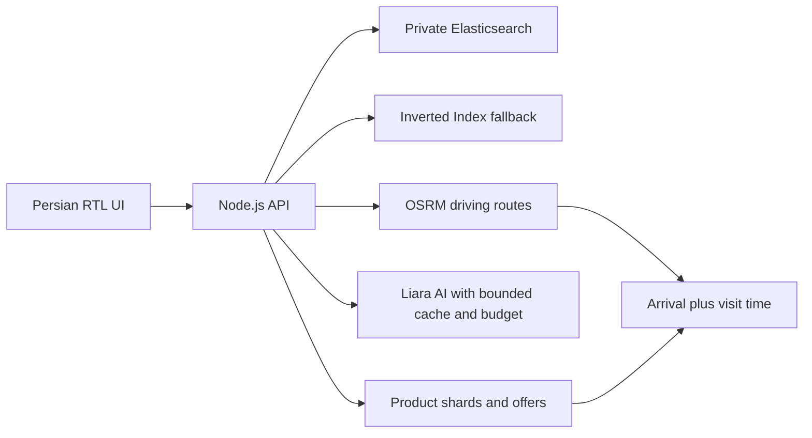

# ترب‌یار | Torob Yar

**همراه فارسی خرید حضوری؛ از انتخاب محصول تا تصمیم برای رفتن به فروشگاه.**

[اجرای آنلاین](https://torob-yar-next-1023.liara.run) · [وضعیت CI/CD](https://github.com/ashkanhfz/torob-yar/actions) · [راهنمای استقرار](docs/CI-CD.fa.md)

ترب‌یار محصول و فروشنده را کنار شرایط مراجعه بررسی می‌کند: فاصله، ساعت کاری، قیمت ثبت‌شده، شرایط پرداخت و ابهام موجودی. کاربر با کارت‌ها، فیلترها و نقشه پیش می‌رود؛ گفتگو با مدل زبانی اختیاری است. این پروژه مستقل است و سرویس رسمی ترب نیست.

## روال خرید

1. نیاز، مدل یا دسته را جست‌وجو کنید؛ بودجه و شرایط خرید را بدون شروع دوباره تغییر دهید.
2. محصولات را مقایسه کنید و فروشنده‌های دارای **آفر همان محصول** را ببینید. فعالیت یک فروشگاه در یک دسته، معادل موجودی محصول نیست.
3. محدوده و ساعت مراجعه را مشخص کنید؛ دلیل پیشنهاد، آدرس، طبقه/واحد ثبت‌شده و وضعیت نامعلوم اطلاعات را بررسی کنید.
4. مقصد را به برنامه خرید اضافه کنید، مسیر خودرو و زمان تخمینی رسیدن را ببینید و ساعت رسیدن را با برنامه کاری فروشگاه مقایسه کنید.
5. اگر فروشگاه بسته بود یا پاسخ نداد، آن را کنار بگذارید و با حفظ شروط سراغ گزینه بعدی بروید. یادداشت و نتیجه پیگیری کاربر از داده تأییدشده فروشنده جدا می‌ماند.

رابط فارسی، راست‌به‌چپ و مناسب موبایل است؛ تاریخ‌ها شمسی‌اند. نقشه و ابزارهای مسیر هنگام نیاز بارگیری می‌شوند. مشخصات و پیشنهادهای بیشتر نیز مرحله‌ای دریافت می‌شوند تا اولین صفحه سبک بماند.

## تصمیم‌های فنی

| تصمیم | دلیل و مرز آن |
| --- | --- |
| **Elasticsearch + Inverted Index داخلی** | ES برای بازیابی و مرتب‌سازی کاتالوگ است؛ ایندکس معکوس داخلی در قطعی یا کندی ES ادامه جست‌وجو را ممکن می‌کند. ES جایگزین داده مرجع محصول نیست. |
| **ایندکس نسخه‌دار و alias اتمیک** | ورود ناقص داده، نسخه فعال را خراب نمی‌کند. بعد از شمارش اسناد alias تغییر می‌کند؛ پاک‌سازی نسخه‌های قدیمی عملیاتی جداست. |
| **نرمال‌سازی فارسی و جست‌وجوی پیشوندی** | تفاوت حروف و اعداد و عبارت ناقص قابل مدیریت است. دسته محصول برای کاهش غلبه لوازم جانبی در رتبه‌بندی استفاده می‌شود. |
| **بارگیری مرحله‌ای و صفحه‌بندی** | نتایج اولیه و بخش‌های موردنیاز زودتر قابل استفاده‌اند؛ لازم نیست کل کاتالوگ یا کتابخانه نقشه در شروع دانلود شود. |
| **سرور Node.js بدون وابستگی npm در زمان اجرا** | تصویر و سطح نگهداری کوچک می‌ماند. هزینه این انتخاب، نگهداری صریح اعتبارسنجی، کش و قرارداد API است. |
| **مدل زبانی اختیاری در سرور** | مدل برای فهم نیاز و راهنمایی است؛ قیمت، آفر و مسیر از داده و ابزار محاسبه می‌شوند. جست‌وجوی عادی نیازمند فراخوانی پولی مدل نیست. |
| **OSRM برای مسیر خودرو** | هندسه، فاصله و زمان مسیر از موتور مسیریابی می‌آیند؛ زمان تخمینی است و ترافیک زنده ندارد. فاصله مستقیم فروشگاه با فاصله مسیر یکی نیست. |
| **اطلاعات نامعلوم صریح** | قیمت ثبت‌شده، زمان تغییر قیمت، ساعت کاری و موجودی تأییدشده مستقل‌اند؛ نبود داده با حدس قطعی پر نمی‌شود. |

الگوی داده: شاخص کوچک محصول برای بازیابی، جزئیات بخش‌بندی‌شده برای نمایش، آفرها برای اتصال محصول به فروشگاه، و داده فروشگاه برای شرایط مراجعه. فقط اطلاعاتی که در منبع وجود دارد نمایش داده می‌شود.



مدل فقط برای راهنمایی اختیاری فراخوانی می‌شود؛ سقف مصرف، ادغام درخواست هم‌زمان و کش پایدار یک‌ساعته هزینه را محدود می‌کنند. زمان رسیدن از مدت هر بخش مسیر و توقف‌های قبلی محاسبه می‌شود؛ ساعت کاری نامعلوم به باز بودن تبدیل نمی‌شود.

## اجرا روی سیستم خودتان

نیازمندی‌ها: **Node.js 22+** و **Python 3.10+**. برای اجرای برنامه `npm install` لازم نیست.

```sh
git clone https://github.com/ashkanhfz/torob-yar.git
cd torob-yar
python3 scripts/setup_data.py
npm run index:prepare
npm start
```

سپس `http://localhost:3000` را باز کنید. بدون تنظیم اتصال‌های خارجی، جست‌وجوی داخلی کار می‌کند. نام متغیرهای اختیاری در [.env.example](.env.example) آمده؛ آن‌ها را در محیط پردازش سرور تنظیم کنید. `.env` خودکار توسط Node بارگذاری نمی‌شود.

دیتاست در Git بازنشر نشده است. اسکریپت آماده‌سازی، ZIP رسمی را دریافت و خروجی را اعتبارسنجی می‌کند. برای استفاده از فایل دانلودشده:

```sh
python3 scripts/setup_data.py --archive /path/to/starcoach-dataset-v16-cap300-csv.zip
```

[دیتاست رسمی v16](https://startech.s3.ir-central1.arvanstorage.ir/starcoach-dataset-v16-cap300-csv.zip?versionId=) شامل **۲۲۵٬۹۰۳ محصول، ۳۳۱٬۵۰۶ آفر و ۶٬۴۷۶ فروشگاه** است. داده‌های ساخته‌شده، کلیدها و فایل‌های محیطی وارد Git نمی‌شوند.

## بررسی و انتشار

```sh
npm run check
npm run test:unit
# پس از آماده‌سازی دیتاست:
npm test
python3 scripts/verify_data.py
```

GitHub Actions بررسی نحوی و تست‌های واحد را اجرا می‌کند؛ سپس ZIP رسمی با checksum مشخص دریافت می‌شود، داده و ایندکس بازسازی می‌شوند، آزمون‌های یکپارچه اجرا می‌شوند و تصویر Docker در محدودیت ۵۱۲ مگابایت حافظه بررسی می‌شود. فقط push موفق به `main` مرحله انتشار روی لیارا را اجرا می‌کند. پس از انتشار، سلامت، جست‌وجوی واقعی و SHA نسخه منتشرشده کنترل می‌شوند. جزئیات و secret موردنیاز در [راهنمای CI/CD](docs/CI-CD.fa.md) است.

```sh
docker build -t torob-yar .
docker run --rm -p 3000:3000 --env-file .env torob-yar
```

داده باید قبل از ساخت image آماده باشد. برنامه روی پورت ۳۰۰۰ اجرا می‌شود و تنظیمات پایدار سرور و دیسک runtime در انتشار حفظ می‌شوند.

## وضعیت سرویس‌ها و محدودیت‌ها

| بخش | وضعیت |
| --- | --- |
| وب و CI/CD | روی لیارا فعال؛ انتشار خودکار از `main` همراه smoke test. |
| Elasticsearch | سرویس خصوصی ساخته شده و تمام ۲۲۵٬۹۰۳ محصول وارد شده‌اند؛ اتصال برنامه با کاربر فقط‌خواندنی در این نسخه تنظیم شده است. |
| جست‌وجوی داخلی | همراه برنامه باقی می‌ماند و مسیر جایگزین ES است. |
| هوش مصنوعی | در سرور پیکربندی شده؛ مصرف و دسترسی تابع سرویس مدل است. بدون آن مسیرهای اصلی محصول کار می‌کنند. |
| مسیریابی آنلاین | در حال حاضر از OSRM عمومی استفاده می‌کند. راه‌اندازی OSRM مستقل روی سرور تولید انجام نشده؛ ابزار آماده‌سازی و اجرای محلی موجود است. |
| تماس و موجودی زنده | متصل نیست. پیگیری ثبت‌شده کاربر، تماس خودکار یا تأیید واقعی فروشنده محسوب نمی‌شود. |

**تمام شماره‌های تلفن دیتاست جعلی‌اند و بیشتر نام فروشگاه‌ها ساختگی است.** با این شماره‌ها تماس واقعی انجام نمی‌شود. اطلاعات نمونه محدود به بخشی از فروشگاه‌های تهران و حداکثر ۳۰۰ محصول هر فروشگاه است؛ نبود محصول در دیتاست به معنی نبود آن در بازار نیست. قیمت‌ها و ساعت کاری ثبت‌شده، تضمین وضعیت امروز نیستند.

ES روی یک نود با یک گیگابایت RAM و دیسک ۱۰ گیگابایتی اجرا می‌شود؛ افزونگی چندنودی ندارد. هزینه این سرویس جدا از وب، بر اساس تعرفه حساب هنگام راه‌اندازی، حدود **۱٬۸۰۶ تومان در ساعت** یا **۱٫۳ میلیون تومان برای ۷۲۰ ساعت** است. [جزئیات استقرار ES، دسترسی محدود و نتیجه بررسی واقعی](docs/ELASTICSEARCH-LIARA.fa.md).

## مستندات بیشتر

- [معماری جست‌وجو و Elasticsearch محلی](docs/SEARCH.fa.md)
- [نگاشت کامل داده، تطبیق با CSV و آمار فیلدهای نامعلوم](docs/DATA.fa.md)
- [اندازه‌گیری عملکرد و Lazy Loading](docs/PERFORMANCE.fa.md)
- [مسیریابی OSRM، اجرای محلی و محدودیت‌ها](docs/ROUTING.fa.md)
- [ایده محصول و اولویت‌ها](docs/PRODUCT.fa.md)، [داستان‌های کاربری](docs/USER_STORIES.fa.md) و [روال‌ها](docs/FLOWS.fa.md)
- [جزئیات پیاده‌سازی](docs/IMPLEMENTATION.fa.md) و [فهرست قابلیت‌ها](FEATURES.md)

مستندات ایده و نقشه راه شامل پیشنهادهای آینده نیز هستند؛ وضعیت سرویس‌های واقعی در جدول بالا مشخص است.
