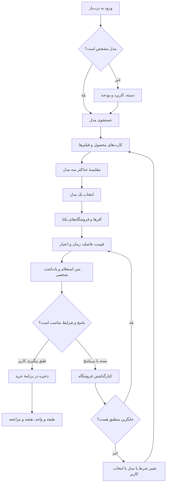
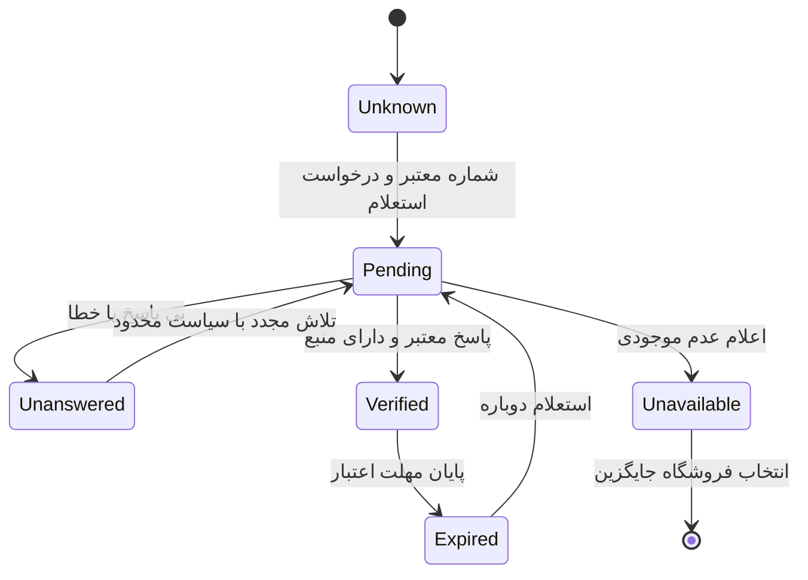
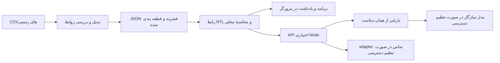

# مسیرهای محصول

## مسیر اصلی موجود

در این نمودار «پاسخ مناسب» گزارش کاربر است، نه تأیید خودکار فروشگاه. نسخهٔ موجود، تماس واقعی انجام نمی‌دهد.

## چرخهٔ تأیید پیشنهادی — هنوز پیاده نشده

قیمت، موجودی، ساعت و شرایط پرداخت باید وضعیت‌های مستقل داشته باشند. تأیید قیمت نباید موجودی را هم تأیید کند. اعتبار پاسخ باید به تنوع دقیق محصول و فروشگاه محدود باشد. یادداشت شخصی کاربر مستقیماً وارد وضعیت Verified نمی‌شود.

## ساختار فنی موجود

خروجی static، مسیرهای Node را اجرا نمی‌کند. adapter تماس فعلی فقط درخواست را ارسال می‌کند؛ دریافت و تصدیق نتیجه و ذخیرهٔ تأیید هنوز وجود ندارد.
